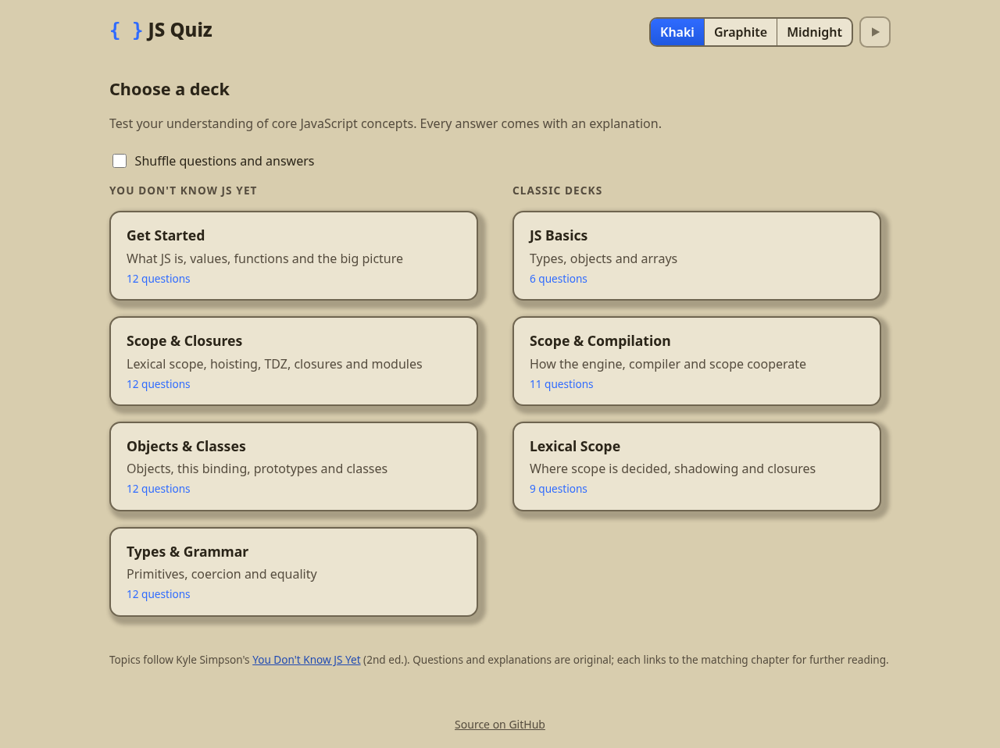
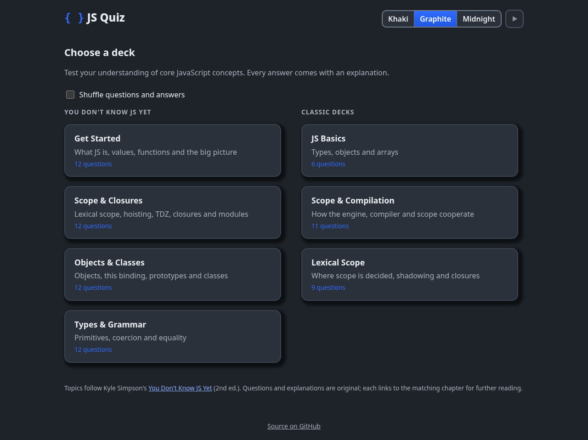
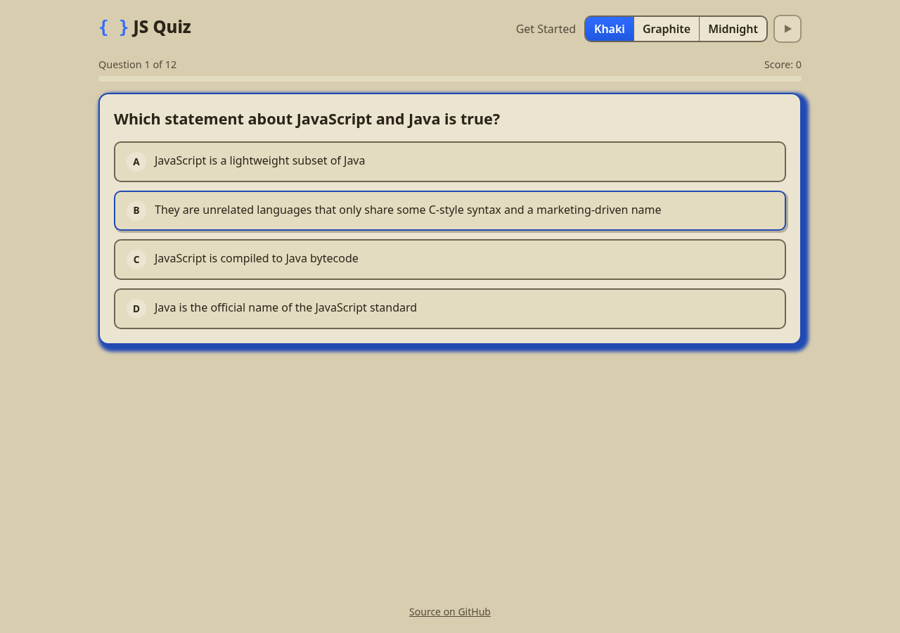
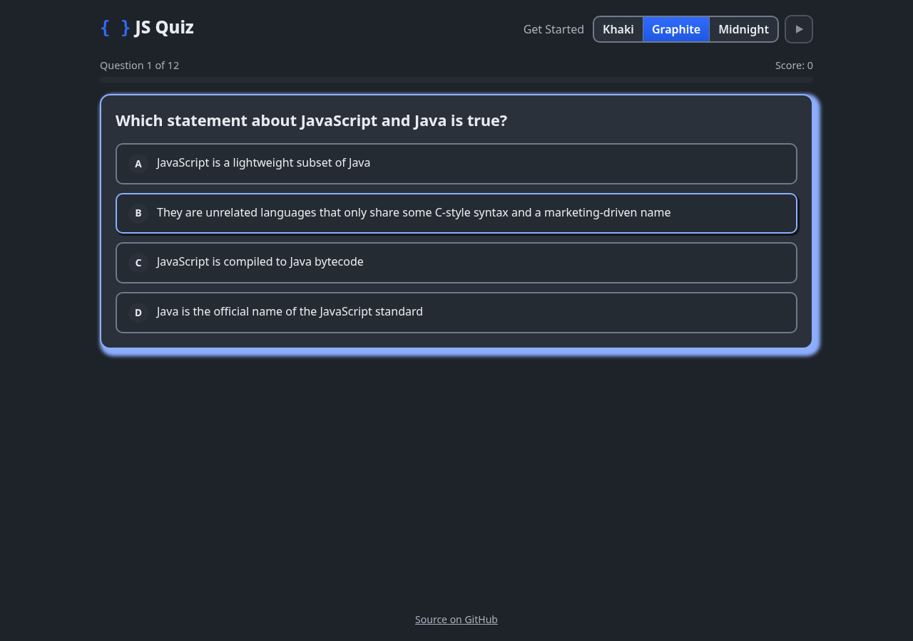

# JS Quiz

A JavaScript concepts quiz: pick a deck, answer multiple-choice questions, read an explanation after each one, and review the ones you missed at the end.

**Live:** https://ali1129js.github.io/quiz-app/

Tag: Rebuilt (original 2019), AI pair-programmed 2026

## Screenshots

Desktop (1280px). Motion is off (the default). Khaki is the light theme; Graphite is the dark grey one.

**Deck picker, Khaki**



**Deck picker, Graphite**



**A question, Khaki**



**A question, Graphite**



See [docs/LEARN.md](docs/LEARN.md) for how the pure quiz reducer, startup deck validation, and best-score storage work.

## Features

- 8 decks, 84 questions, grouped by book:
  - **You Don't Know JS Yet**: Get Started (12), Scope & Closures (12), Objects & Classes (12), Types & Grammar (12)
  - **Classic decks** (from the original app, audited and rewritten): JS Basics (6), Scope & Compilation (11), Lexical Scope (9)
  - **JavaScript concepts**: Async / Promises (10), with further-reading links to MDN (the 2nd-edition YDKJS series has no async book yet)
- An explanation after every answer, with the correct and wrong choices highlighted
- A "Further reading" link on every question to the matching book chapter, or to MDN on the Async / Promises deck
- A progress bar and a running score
- A results screen with a percentage, a review of missed questions, a "Practice missed" run of those ids, a restart button and a way to switch decks. Missed ids are kept per deck (Zod-checked) until they are answered right.
- An optional shuffle for both questions and answers
- Your best score for each deck, saved in `localStorage`
- Accessible: real `<button>` options, full keyboard support, focus moved on each step, a live region for feedback, and visible focus rings
- Three gloss themes (Khaki, Graphite, Midnight). The first visit follows the operating system. An optional slow background motion stays off by default and is forced off when you prefer reduced motion.

## Stack

Vite 6 · React 19 (function components + `useReducer`) · TypeScript (strict, `noUncheckedIndexedAccess`, `exactOptionalPropertyTypes`) · Vitest + Testing Library · ESLint (typescript-eslint strict)

```
src/
  data/*.json         decks: { id, book, title, description, questions: Question[] }
  types.ts            Question { id, prompt, code?, options, answerIndex, explanation, source }
  decks.ts            loads and validates decks at startup, groups them by book
  quiz.ts             pure reducer, scoring, shuffling
  storage.ts          best scores in localStorage
  components/         DeckPicker, ProgressBar, QuestionCard, Results
  test/               unit tests + UI flow tests
```

## Scripts

```bash
npm ci
npm run dev        # local dev server
npm test           # vitest
npm run lint
npm run typecheck
npm run build      # outputs dist/ with base path /quiz-app/
npm run preview
```

## Adding questions

Add an entry to a deck in `src/data/`. `answerIndex` is the 0-based index into `options`, and `source` must be an https link. Invalid decks fail on startup and in tests. Before adding a code snippet question, run the snippet in Node to confirm the output.

## Deployment

`.github/workflows/deploy.yml` runs lint, typecheck, tests and build on every push and PR. On pushes to `main`/`master` it deploys `dist/` with `actions/deploy-pages`. Pages is set to **GitHub Actions** (it used to be served from the `gh-pages` branch via `npm run deploy` in the old app).

## Attribution

The topics follow Kyle Simpson's [**You Don't Know JS Yet**](https://github.com/getify/You-Dont-Know-JS/tree/2nd-ed) (2nd edition), © Kyle Simpson, licensed [CC BY-NC-ND 4.0](https://creativecommons.org/licenses/by-nc-nd/4.0/). All questions, code samples and explanations in this app are original and are not taken from the book. Each question links to the relevant chapter, or to MDN on the Async / Promises deck, for further reading. This project is not affiliated with or endorsed by the author.

## AI-assisted

This 2026 rebuild (porting from Create React App 2 / React 16 to Vite + React 19 + TypeScript, the tests, and drafting the new decks) was done with the help of an AI assistant and reviewed before merging. All code snippet outputs were checked by running them in Node.
